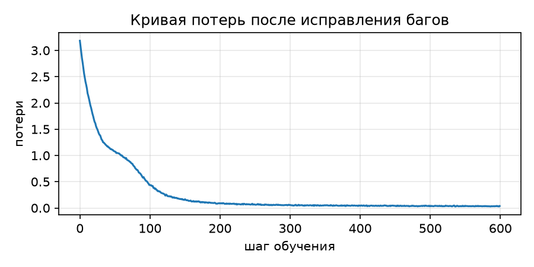

# ДЗ 1. Внимание своими руками

В [первом ноутбуке](dz1-attention.ipynb) реализованы разбиение на головы, обратная сборка, внимание с причинной маской и блок трансформера. Во [втором ноутбуке](dz1-bughunt.ipynb) разобраны три ошибки варианта 42. Таблица с исправлениями находится перед обучением.

## Как повторить

1. Скачайте оба файла `.ipynb`. В Google Colab выберите «Файл → Открыть блокнот → Загрузить» и откройте первый файл.
2. Нажмите «Среда выполнения → Выполнить все». В конце должно появиться «пройдено 17 из 17».
3. Откройте второй файл так же. В настройках среды выполнения можно выбрать GPU T4. Запустите все ячейки сверху вниз. После проверок ноутбук обучит модель, построит график и напечатает 200 новых символов. Корпус задан прямо в ячейке.

## Результат

Локальный прогон на CPU (macOS arm64, Python 3.12.14, PyTorch 2.14.1, matplotlib 3.11.2). Seed обучения — 0. В обоих ноутбуках прошли все 17 проверок. На другом устройстве числа и генерация могут немного отличаться.

За 600 шагов потери на обучающих батчах снизились с 3,184 до 0,037. Корпус состоит из одной повторяющейся фразы, и модель научилась её продолжать.

Начало генерации из символа «а»:

> алгоритм внимания смотрит на все позиции сразу. алгоритм внимания смотрит на все позиции сразу.
